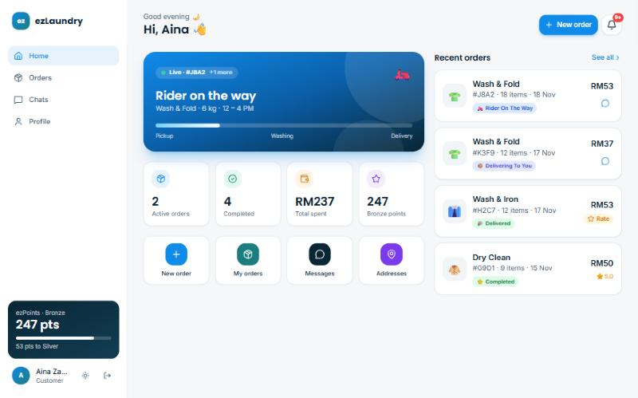
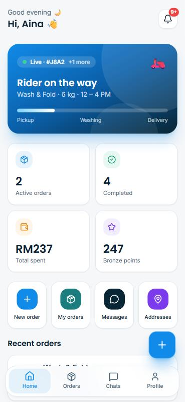
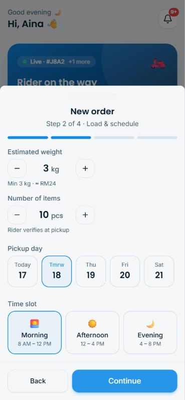
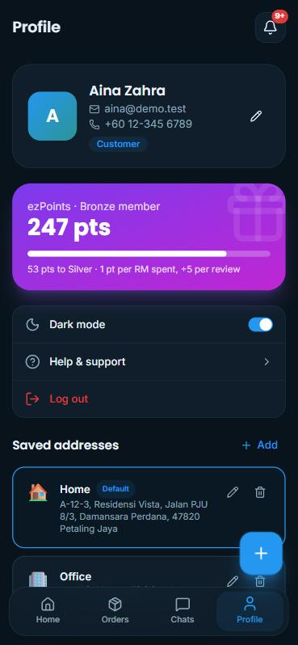
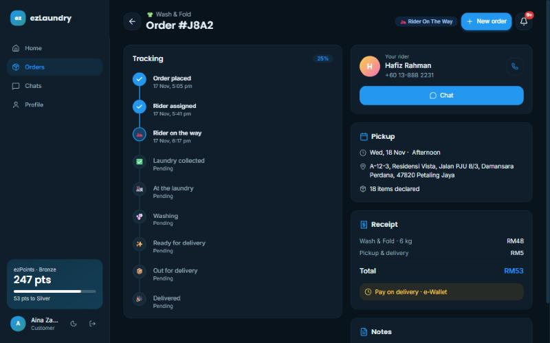
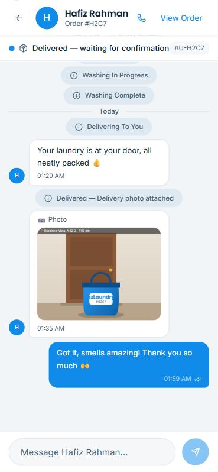
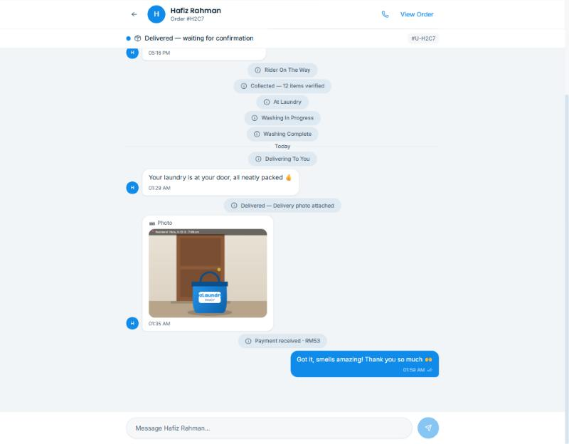
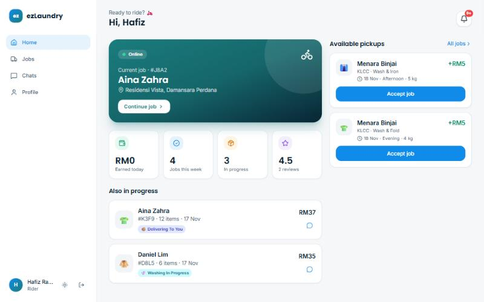
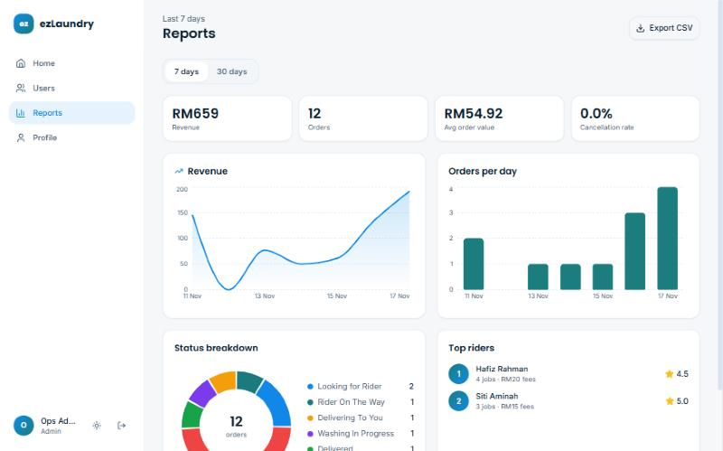
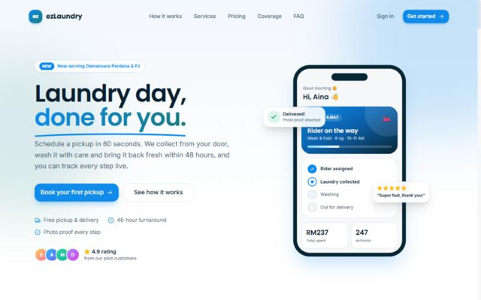

# ezLaundry 🧺

**Door-to-door laundry pickup and delivery for busy urban Malaysians.**
Customers schedule a pickup, a rider collects the laundry, it is washed at a partner facility, and it comes back fresh within 48 hours. Every step is tracked live.

ezLaundry is a responsive web app for **mobile and desktop** with three roles: **Customer**, **Rider** and **Admin**. It is built with React, TypeScript, Tailwind CSS, Framer Motion and Firebase.

### 🔗 Live demo: **[ezlaundry-c7d95.web.app](https://ezlaundry-c7d95.web.app)**

Create an account and pick a role (Customer, Rider or Admin) to try it. Open it on your phone too: the layout is built for both.



---

## ✨ Features

### For customers
- **Live order tracker**: a 9-step animated timeline (rider assigned → collected → washing → out for delivery → delivered) with live updates.
- **New order in 4 steps**: service → load & schedule → address & payment → review. It opens as a **bottom sheet on mobile** and a **dialog on desktop**.
- **Saved addresses**: Home, Office and more, with a default address preselected at checkout.
- **Pay on delivery**: choose cash or e-wallet. A receipt shows the price breakdown and payment status.
- **Rate your rider**: stars, quick tags and a comment after each delivery.
- **ezPoints loyalty**: 1 point per RM spent plus 5 per review, with Bronze, Silver and Gold tiers.
- **Notifications bell**: every status change of your orders, with unread badges.
- **In-app chat** with your rider for each order. Every status change is posted into the chat automatically, and the rider's delivery photo shows up there too.

### For riders
- **Job board**: accept available pickups. Cards animate out of the list as soon as you accept.
- **Step-by-step job flow**: start pickup → record pickup (verify item count) → laundry → washing → delivery with photo proof.
- **Collect payment** button and **earnings and rating stats**.

### For admins
- **Operations dashboard**: revenue, active orders, riders on a job and average rating, all calculated from real data.
- **Reports**: revenue area chart, orders-per-day bars and a status donut, with a 7/30-day range, top riders and **CSV export**.
- **User management**: search, view and delete customers and riders.

### UI / UX
- **Responsive app shell**: a floating bottom tab bar on phones and a sidebar on desktop, each with a sliding active highlight.
- **Smooth motion**: page transitions, staggered card entrances, count-up numbers, press feedback, skeleton loaders and confetti when an order is placed.
- **Light and dark mode**, saved per device. The landing and auth pages stay light.
- **Accessible by default**: respects `prefers-reduced-motion`, uses keyboard-friendly Radix primitives and proper confirm dialogs instead of `alert()`.

---

## 📸 Screens

| Mobile home | New order sheet | Profile (dark) |
|---|---|---|
|  |  |  |

**Live order tracker (dark mode)**


**Order chat: status updates and delivery photo**

| Mobile | Desktop |
|---|---|
|  |  |

**Rider home**


**Admin reports**


**Landing page**


---

## 🛠 Tech stack

| Area | Tools |
|---|---|
| Framework | React 19, TypeScript, Vite 7 |
| Styling | Tailwind CSS 3, shadcn/ui (Radix), CSS-variable theme tokens |
| Motion | Framer Motion 12 |
| Charts | Recharts |
| UI bits | sonner (toasts), vaul (bottom sheets), lucide-react (icons), next-themes |
| Backend | Firebase Authentication, Cloud Firestore, Firebase Hosting |
| Testing | Vitest (business logic) |

---

## 🚀 Getting started

```bash
cd app
npm install
```

### Run with your Firebase project

Create `app/.env` with your Firebase web config:

```env
VITE_FIREBASE_API_KEY=...
VITE_FIREBASE_AUTH_DOMAIN=...
VITE_FIREBASE_PROJECT_ID=...
VITE_FIREBASE_STORAGE_BUCKET=...
VITE_FIREBASE_MESSAGING_SENDER_ID=...
VITE_FIREBASE_APP_ID=...
```

```bash
npm run dev
```

### Run in local demo mode (no Firebase needed)

```bash
npm run dev:demo
```

Demo mode swaps Firebase Auth, Firestore and chat for an in-browser mock that is saved to `localStorage`. Register a customer, a rider and an admin to try every role. Data stays in your browser and nothing is sent to Firebase.

### Other scripts

| Command | What it does |
|---|---|
| `npm run build` | Type-check and build to `dist/` |
| `npm test` | Run the Vitest unit tests |
| `npm run lint` | Run ESLint |
| `npm run preview` | Preview the production build |

---

## 🗂 Project structure

```
app/src
├── components/
│   ├── shell/        # AppShell, Sidebar, BottomNav, TopBar, NotificationBell
│   ├── order/        # OrderCard, ActiveOrderHero, OrderTimeline, Receipt, RateRiderModal
│   ├── profile/      # AddressManager
│   ├── admin/        # Recharts wrappers
│   ├── ui/           # shadcn/ui primitives
│   ├── motion.tsx    # PageTransition, Stagger, CountUp, Pressable
│   └── CreateOrderDialog.tsx, ResponsiveModal.tsx, ConfirmDialog.tsx, ...
├── pages/            # Customer, rider, admin and chat pages
├── sections/         # Landing page sections
├── lib/              # Pure logic: loyalty, notifications, reports, addresses, dates (+ tests)
├── services/         # Firebase access: auth, orders, chats, content
├── hooks/            # Data hooks (orders, notifications, unread chats)
└── contexts/         # AuthContext
```

### Order lifecycle

```
pending → accepted → picking-up → picked-up → to-laundry → at-laundry
        → washing → washed → delivering → delivered → completed
(pending / accepted → cancelled)
```

---

## ☁️ Deployment

Pushing to `main` builds the app and deploys it to **Firebase Hosting** through the GitHub Actions workflows in `.github/workflows`.

---

## 📄 License

This is a portfolio project. All rights reserved by the author.
